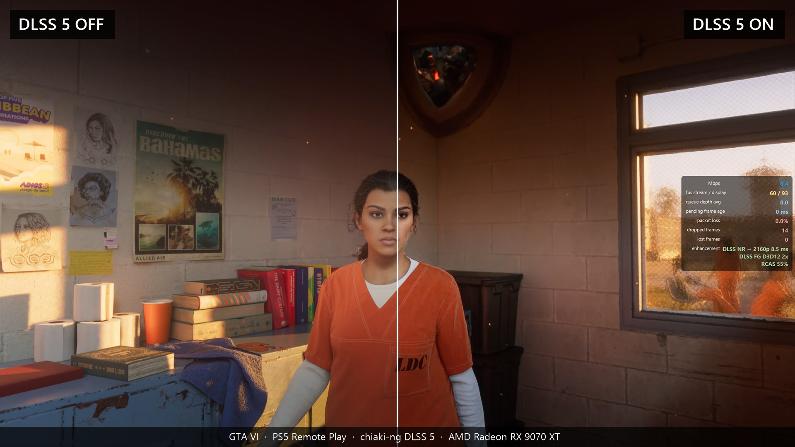
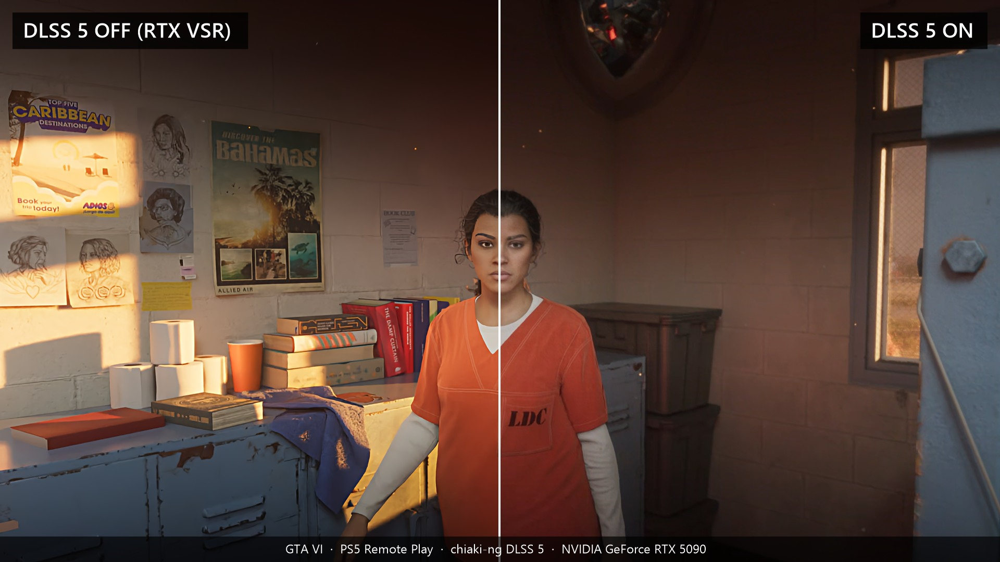
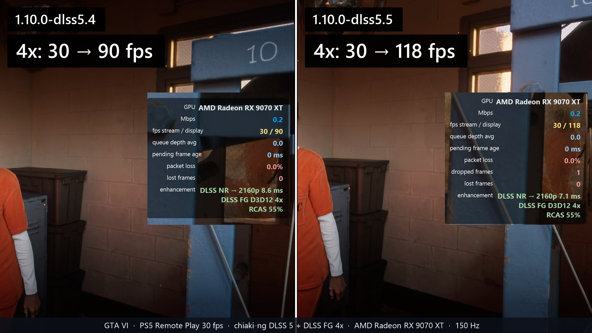
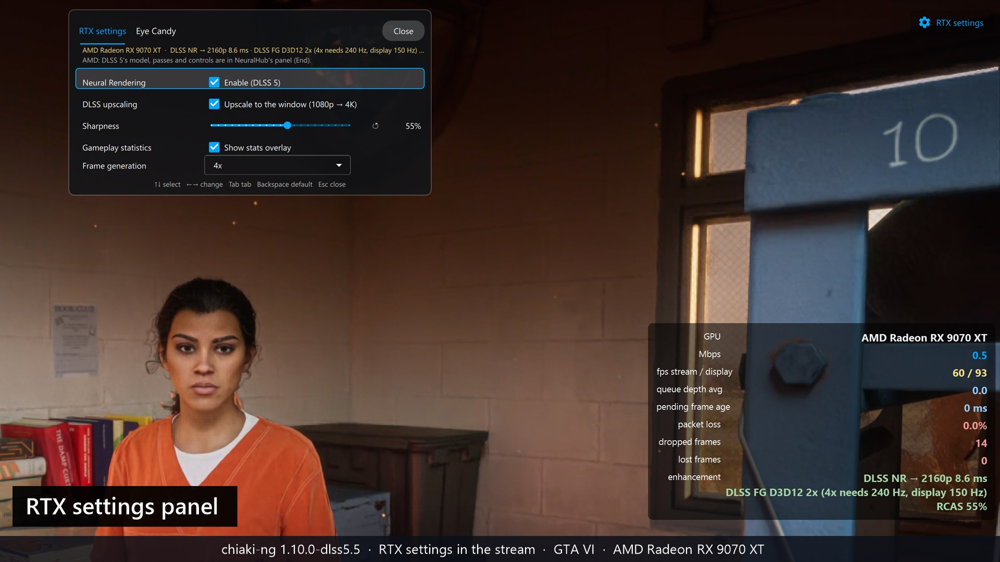

# chiaki-ng-enhanced

A fork of [chiaki-ng](https://github.com/streetpea/chiaki-ng) (the open source PlayStation 4/5 Remote Play client) that adds video enhancement and smoother streaming on top of upstream: NVIDIA RTX Video Super Resolution, four frame generation backends (NVIDIA VFG, DLSS, FSR and its own **Flow** interpolation; FSR and Flow also run on Linux and Steam Deck), an ambient border for ultrawide displays and a set of Windows streaming tweaks and fixes.

The `d3d12-bridge` branch adds **DLSS 5 neural rendering** and **DLSS Frame Generation through D3D12** on NVIDIA RTX and AMD Radeon GPUs (AMD through NeuralHub), see [DLSS 5 and DLSS FG through D3D12](#dlss-5-and-dlss-fg-through-d3d12-d3d12-bridge).

Everything else (setup, registration, controllers, Steam Deck usage) works as in upstream chiaki-ng – see its [documentation site](https://streetpea.github.io/chiaki-ng/).

## Latest release: [1.10.0-dlss5.7](https://github.com/windystrife/chiaki-ng-Ultimate/releases/tag/1.10.0-dlss5.7) (21 November 2026)

DLSS 5 and DLSS Frame Generation in PS5 Remote Play on **NVIDIA RTX and AMD Radeon** (Windows):



| DLSS 5 off (RTX VSR) / on, RTX 5090 | 4x frame generation, 5.4 vs 5.5, RX 9070 XT | RTX settings panel while streaming |
|---|---|---|
|  |  |  |

<sub>GTA VI © Rockstar Games. Screenshots from real PS5 Remote Play streams, for illustration.</sub>

- **New in 5.7: DLSS Frame Generation on RTX 20 / RTX 30.** With [MFG Unlocker](https://github.com/dashdogy/MFG-Unlocker) next to `chiaki.exe` as `version.dll` (the kit offers to download it), chiaki-ng runs DLSS FG through NVIDIA Streamline: on an RTX 3070, 2x at 1080p and 4x at 720p, and chiaki-ng lowers the multiplier by itself when the card cannot keep up.
- **New in 5.6: DLSS Frame Generation next to DLSS 5 on NVIDIA** goes straight to the pipelined D3D12 path (NGX refuses Vulkan DLSS FG once DLSS 5 has its D3D12 side up), and **one setup kit for NVIDIA and AMD** (`setup.cmd`) that also gets DLSS 5's `nvngx_dlssnr.dll` and, on AMD, installs and sets up NeuralHub.
- **4x frame generation keeps up with DLSS 5**: the next stream frame's DLSS work runs while the generated frames are shown. RX 9070 XT, GTA VI at 30 fps, DLSS 5 to 2160p, 4x on a 150 Hz screen: **118 fps** (1.10.0-dlss5.4: about 90).
- **RTX settings panel** while streaming, on every GPU: DLSS 5 on/off, upscaling, sharpness, frame generation Off / 2x / 3x / 4x and the stats overlay; on NVIDIA also the DLSS 5 model, 1–3 passes and their controls.
- **Stats overlay** names the GPU and says when the display holds frame generation back (e.g. 4x needs 120 Hz for a 30 fps stream).

| You have | Get | Then |
|---|---|---|
| AMD Radeon | [`chiaki-dlss5-setup-full.zip`](https://github.com/windystrife/chiaki-ng-Ultimate/releases/download/1.10.0-dlss5.7/chiaki-dlss5-setup-full.zip) | Unzip the kit and run `setup.cmd`: it installs NeuralHub, imports the DLSS DLLs into it and sets up chiaki-ng |
| NVIDIA RTX | [`chiaki-dlss5-setup-full.zip`](https://github.com/windystrife/chiaki-ng-Ultimate/releases/download/1.10.0-dlss5.7/chiaki-dlss5-setup-full.zip), or [`setup.exe`](https://github.com/windystrife/chiaki-ng-Ultimate/releases/download/1.10.0-dlss5.7/chiaki-ng-1.10.0-dlss5.7-win_x64-setup.exe) / the portable zip | Unzip the kit and run `setup.cmd`: it finds `nvngx_dlssnr.dll` (DLSS NR 310.9.16, not bundled) on the PC or downloads it, and copies it next to `chiaki.exe` (by hand: copy it there yourself). On RTX 20 / RTX 30 it also offers MFG Unlocker for DLSS Frame Generation |

Setup guides: [English (PDF)](https://github.com/windystrife/chiaki-ng-Ultimate/releases/download/1.10.0-dlss5.7/chiaki-ng-dlss5-guide-en.pdf), [Tiếng Việt (PDF)](https://github.com/windystrife/chiaki-ng-Ultimate/releases/download/1.10.0-dlss5.7/chiaki-ng-dlss5-huong-dan.pdf). Full notes on the [release page](https://github.com/windystrife/chiaki-ng-Ultimate/releases/tag/1.10.0-dlss5.7).

## Downloads

Releases and pre-releases are published on the [Releases](../../releases) page (tags like `1.10.0-rtx.4`):

| File | Platform |
|---|---|
| `chiaki-ng-*-win_x64-setup.exe` | Windows x64 installer |
| `chiaki-ng-*-win_x64-portable.zip` | Windows x64 portable |
| `chiaki-ng-*-linux_x86_64.AppImage` | Linux x86_64 (`chmod +x`, then run) |

DLSS 5 builds from the `d3d12-bridge` branch use tags like `1.10.0-dlss5.7` and also ship:

| File | Contents |
|---|---|
| `chiaki-dlss5-setup-full.zip` | Setup kit for NVIDIA and AMD with the portable build inside; 5.5 had the AMD-only `chiaki-dlss5-amd-setup-full.zip` |
| `chiaki-dlss5-setup.zip` | The same setup kit, downloading the portable build from GitHub |
| `chiaki-ng-dlss5-guide-en.pdf`, `chiaki-ng-dlss5-huong-dan.pdf` | Setup guide for AMD and NVIDIA (English, Vietnamese) |

Test builds of every commit are available as artifacts of the *Build chiaki-ng Windows x86_64 (VC)* and *Build chiaki-ng Appimage x86_64* workflows in the Actions tab.

## What this fork adds

### Video enhancement

| Feature | Platforms | GPU | Where |
|---|---|---|---|
| **RTX Video Super Resolution** – AI upscaling of the stream to the window size (Low / Medium / High / Ultra) | Windows | NVIDIA RTX 20 series or newer | Settings → Video, or Ctrl+O → Enhancement |
| **NVIDIA VFG** – NVIDIA's video-trained frame generation (Video Effects SDK), 2x–4x, Low / Medium / High; the least "jelly" option for 30 fps games. NVIDIA runtime downloaded on request (installer option or settings button) | Windows | NVIDIA RTX 40/50 | Settings → Video, or Ctrl+O → Enhancement |
| **DLSS Frame Generation** – 2x, 3x/4x on RTX 50 series; gets per-pixel motion vectors from Flow's motion search (less jelly at moving edges) | Windows | NVIDIA RTX 40 series or newer | Settings → Video, or Ctrl+O → Enhancement |
| **FSR 3.1 Frame Generation** – 2x, with per-pixel motion vectors from Flow's motion search (built from the FidelityFX SDK sources on Linux) | Windows, Linux | any Vulkan GPU | Settings → Video, or Ctrl+O → Enhancement |
| **Flow Frame Generation** – chiaki-ng's own optical flow interpolation, 2x–4x | Windows, Linux, Steam Deck | any Vulkan GPU | Settings → Video, or Ctrl+O → Enhancement |
| **Generated Frame Clean-up** – keeps HUD and text sharp and in place in generated frames; optional detail pass against smeared in-between frames | all | any | Settings → Video, or Ctrl+O → Enhancement |
| **AMD RCAS sharpening** – contrast adaptive sharpening of the final picture with a strength slider; works after upscaling, RTX VSR and frame generation, also at 1:1 | all | any | Settings → Video, or Ctrl+O → Enhancement |
| **Ambient border** – fills the bars around the video (e.g. 16:9 on an ultrawide display) with a blurred copy of the picture | all | any | Settings → Video, or Ctrl+O → Enhancement |

Notes:

- RTX VSR needs `nvngx_vsr.dll` (from the NVIDIA RTX Video SDK) next to `chiaki.exe`; it is not bundled. Only the Upscale modes work with the public 1.6.0 DLL; the Artifact Reduction and Streaming modes need 1.8.2+ and are greyed out otherwise. See [RTX Video](docs/setup/rtxvideo.md).
- Frame generation needs the Vulkan renderer, Frame Delivery = Direct Mapping and a display running at least twice the stream frame rate (e.g. 120 Hz for a 60 fps stream). HDR streams are shown without it. It adds about half a stream frame of latency. See [Frame Generation](docs/setup/framegen.md).
- **Flow** needs no vendor runtime: it is built from libplacebo compute shaders (luma pyramid, coarse-to-fine block matching, per-pixel vector selection, occlusion and scene cut handling). HUD and other static overlays, including anti-aliased text, are detected and kept in place. *Flow Quality*: Performance (1/4 resolution analysis, ~0.5 ms on an RTX 5070 Ti) or Quality (1/2 resolution, a few times the GPU time). Performance is recommended.
- **NVIDIA VFG runtime**: not bundled. *NVIDIA Runtime → Download* (Settings → Video or Ctrl+O → Enhancement) or the installer's *Download the NVIDIA VFG … runtime* option fetches NVIDIA's official `nvidia-vfx` package (~420 MB, SHA-256 checked) and installs the VFG libraries and `nvngx_vsr.dll` 1.8.3, which also unlocks all RTX VSR modes. NVIDIA's license terms apply.
- **30 fps games in a 60 fps stream**: the repeated pictures are detected and dropped while frame generation is on, so it interpolates between real pictures.
- The DLSS (`nvngx_dlssg.dll`) and FidelityFX (`amd_fidelityfx_vk.dll`) runtimes ship with the Windows build; their licenses are in the `licenses` folder. On Linux, FSR 3.1 is built from the bundled FidelityFX SDK 1.1.4 sources (`third-party/ffx-sdk`).

### DLSS 5 and DLSS FG through D3D12 (`d3d12-bridge`)

| Feature | GPU | Where |
|---|---|---|
| **DLSS 5 neural rendering** – NVIDIA's neural rendering model on each stream frame, at the stream size or upscaled 1.5x / 2x toward the window by DLSS Super Resolution (1080p → 4K); SDR and HDR | NVIDIA RTX (`nvngx_dlssnr.dll`, not bundled); AMD Radeon through NeuralHub (not bundled) | Settings → Video, Ctrl+O → Enhancement, RTX settings panel |
| **DLSS Frame Generation via D3D12** – DLSS FG through the same bridge, 2x–4x; the next stream frame's DLSS work runs on D3D12 while the frames generated from the last one are presented | AMD through NeuralHub; NVIDIA next to DLSS 5 (NGX refuses Vulkan DLSS FG once its D3D12 side is up) or when Vulkan DLSS FG fails | Settings → Video, Ctrl+O → Enhancement, RTX settings panel |
| **RTX settings panel** – in-stream panel with *RTX* and *Eye Candy* tabs (DLSS 5, upscaling, sharpness, frame generation multiplier, stats overlay, RTX VSR, clean-up, border fill); a button at the top right when the mouse moves, End on NVIDIA | all | while streaming |
| **DLSS 5 controls (NVIDIA)** – model CC / HT, 1–3 passes, each with its own preset and controls, applied at once | NVIDIA RTX | RTX settings panel (End) |

Notes:

- How it works: the frames are rendered on libplacebo's Vulkan device and shared with a D3D12 device (shared buffers, and a D3D12 fence imported as a Vulkan timeline semaphore), where NGX runs DLSS 5, DLSS Super Resolution and DLSS FG. Vulkan only queues a copy back once the D3D12 side is done, so the presented frames never wait for it. `CHIAKI_FG_PIPELINE=0` turns that off for comparisons.
- **NVIDIA**: put NVIDIA's `nvngx_dlssnr.dll` (DLSS NR 310.9.16) next to `chiaki.exe`, or run the setup kit (`setup.cmd`). The kit takes the best copy on the PC (next to the kit, older chiaki-ng folders, NeuralHub's store, the RHI and DLSS5 Easy Installer caches, Downloads, the desktop), or downloads it the way RHI (ReShade HDR Installer) does: RHI's DLSS manifest points to github.com/RankFTW/rhi-repo releases. The zip must match GitHub's SHA-256 digest, 310.9.16 must be the exact build tested with chiaki-ng, and a newer build is used without asking only if NVIDIA signed it. The file is not in the public DLSS SDK and is not bundled.
- **RTX 20 / RTX 30**: DLSS 5 runs (RTX 3070, driver 610.88, `chiaki-fgdx12test`: 32.8 ms per 1080p frame, 18.1 ms at 720p, so a 720p stream leaves room for 60 fps or frame generation). These cards have no DLSS Frame Generation of their own. With [MFG Unlocker](https://github.com/dashdogy/MFG-Unlocker) (1.7.1, MIT) next to `chiaki.exe` as `version.dll`, chiaki-ng runs DLSS FG through NVIDIA Streamline 2.14.16 (the `sl.*.dll` files come with chiaki-ng; the kit offers to download MFG Unlocker, checked against its SHA-256): on an RTX 3070, 2x at 1080p (the generated frame is ready about 5 ms after the stream frame) and 4x at 720p. When the card cannot keep up with the multiplier you chose (4x at 1080p), chiaki-ng lowers it by itself, from GPU timestamps of the generated frames, and tries a higher one again later. DLSS FG runs while the chiaki-ng window has the focus. Without MFG Unlocker the kit picks Flow frame generation (2x to 4x). RTX 40 cards with MFG Unlocker next to `chiaki.exe` also go through Streamline (not tested); RTX 50 cards always call NGX directly. `CHIAKI_DLSSG_ROUTE=sl` or `ngx` forces a route.
- **AMD**: needs Windows 11 (NeuralHub's requirement); RX 9000 and RX 7000 get every feature, RX 6000 only DLSS 5 for now. Run the setup kit (`setup.cmd`). If NeuralHub is missing it downloads the newest official installer (github.com/danielblnc/DLSS-NR-on-AMD, digest checked) and installs it for the current user, imports DLSS NR, DLSS Super Resolution and DLSS Frame Generation into NeuralHub's store, takes NeuralHub's loader out of `neuralhub.exe` and puts it next to `chiaki.exe`, and writes a tested `neuralhub.ini`. NeuralHub's licence does not allow redistribution, so it is not bundled.
- Measured on GTA VI (PS5, 1080p stream): RX 9070 XT, DLSS 5 + DLSS SR to 2160p about 7–9 ms, 4x of a 30 fps stream shows 118 fps on a 150 Hz screen; RTX 5090, DLSS 5 to 2160p 2.8 ms, and with DLSS FG through D3D12 next to it (5.6) 2x of a 30 fps stream shows 61 fps on a 60 Hz screen.
- 4x needs a display refresh of at least 4x the stream's fps; the stats overlay says when the display holds it back (e.g. `DLSS FG D3D12 2x (4x needs 240 Hz, display 150 Hz)`). The guides cover setup, settings, limits and troubleshooting.

### In-stream controls and stats

- **Enhancement panel (Ctrl+O → Enhancement)**: change RTX VSR mode, frame generation backend / multiplier / Flow quality, RCAS strength and border fill while streaming, without leaving the stream; it shows what is active and the stream / display fps.
- **Stats overlay**: stream fps / display fps, bitrate, packet loss, plus RTX VSR / frame generation state and GPU time (e.g. `VFG 4x 6.8 ms`). Styles Mini / Compact (one line) / Default / Full and nine positions (e.g. one line at the top center); it follows the stream window instead of staying above other applications.
- **Disconnect dialog**: Cancel button and × to keep streaming instead of always closing the stream.

### Streaming and stability

- Windows tuning while streaming: qWAVE QoS on the stream sockets (audio/video traffic class), MMCSS "Games" priority for the network threads, 1 ms timer resolution, no power throttling.
- Fixed the packet loss statistic when sequence numbers wrap around.
- Fixed a swapchain rebuild loop (and log flood) while the window is minimized.
- Crash guard: if the app crashes while frame generation starts, it is turned off on the next launch.
- Upstream fixes picked up: use-after-free crashes on session teardown / controller disconnect / exit, Takion send buffer use after the receive loop ended, reorder queue not clearing dropped entries.

### Builds

- Windows (MSVC/clang-cl) build with the NVIDIA NGX and AMD FidelityFX SDKs, vcpkg binary cache (~12 min per build).
- Linux AppImage build on every push, with FSR 3.1 built from source.
- Tag-driven release workflow (`*-rtx.*` tags) publishing Windows and Linux packages with checksums.

## Building

Same as upstream chiaki-ng, plus for the Windows video features:

```
cmake -DCHIAKI_ENABLE_NGX=ON -DCHIAKI_NGX_SDK_DIR=<NVIDIA DLSS SDK> \
      -DCHIAKI_ENABLE_FFX=ON -DCHIAKI_FFX_SDK_DIR=<AMD FidelityFX SDK 1.1.x> ...
```

Flow frame generation and the ambient border need no extra SDK. On Linux, FSR 3.1 frame generation is built from `third-party/ffx-sdk` (`CHIAKI_ENABLE_FFX_SOURCE`, on by default, needs the Vulkan loader); its shader headers are pre-generated with `scripts/ffx-gen-shaders.py`. See `.github/workflows/build-windows-x86.yml` for the complete Windows build.

## Credits

- [chiaki-ng](https://github.com/streetpea/chiaki-ng) by Street Pea and contributors, based on [Chiaki](https://git.sr.ht/~thestr4ng3r/chiaki) by Florian Märkl.
- NVIDIA DLSS / NGX SDK, RTX Video SDK and Video Effects SDK, AMD FidelityFX SDK, [libplacebo](https://code.videolan.org/videolan/libplacebo).
- NeuralHub (Danielblnc's Neural Rendering Supermod) serves DLSS 5 and DLSS FG on AMD; the setup kit downloads it from its official releases, and it is not part of this project.
- Ideas from [Veyra-NRVideo](https://github.com/Likely7/Veyra-NRVideo) (VFG integration, scene-cut test) and [VeyAmux](https://github.com/8BiTw0LF/VeyAmux) (FSR on Linux, frame clean-up passes).

## Disclaimer

This project is not endorsed or certified by Sony Interactive Entertainment LLC.

Chiaki is a Free and Open Source Software Client for PlayStation 4 and PlayStation 5 Remote Play
for Linux, FreeBSD, OpenBSD, Android, macOS, Windows, Nintendo Switch and potentially even more platforms.
